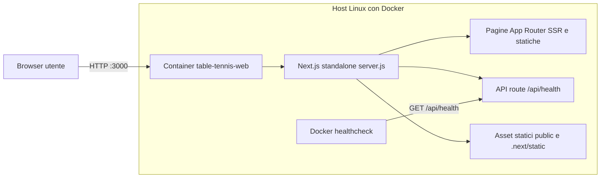
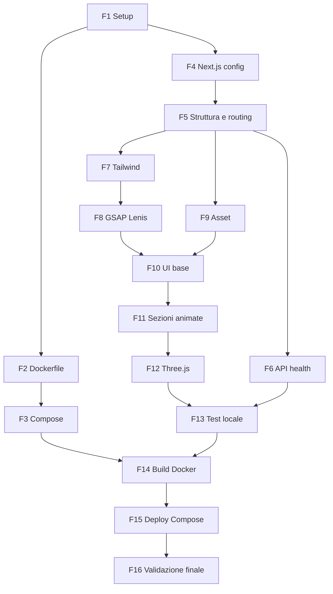

# PIANO DI SVILUPPO - TABLE TENNIS BEYOND THE SPEED

> Documento operativo step-by-step per la realizzazione del sito **"TABLE TENNIS - BEYOND THE SPEED"**: web experience immersiva, completamente containerizzata con Docker, autonoma, funzionante offline e deployabile su qualsiasi server Linux dotato di Docker Engine e Docker Compose V2.

---

## Indice

- [0. Panoramica del progetto](#0-panoramica-del-progetto)
- [FASE 1 - Setup iniziale del progetto](#fase-1---setup-iniziale-del-progetto)
- [FASE 2 - Configurazione Docker: Dockerfile multi-stage](#fase-2---configurazione-docker-dockerfile-multi-stage)
- [FASE 3 - Configurazione Docker Compose](#fase-3---configurazione-docker-compose)
- [FASE 4 - Configurazione Next.js](#fase-4---configurazione-nextjs)
- [FASE 5 - Struttura applicazione e routing](#fase-5---struttura-applicazione-e-routing)
- [FASE 6 - Implementazione endpoint /api/health](#fase-6---implementazione-endpoint-apihealth)
- [FASE 7 - Configurazione Tailwind CSS](#fase-7---configurazione-tailwind-css)
- [FASE 8 - Setup GSAP e librerie di animazione](#fase-8---setup-gsap-e-librerie-di-animazione)
- [FASE 9 - Organizzazione asset](#fase-9---organizzazione-asset)
- [FASE 10 - Implementazione componenti UI base](#fase-10---implementazione-componenti-ui-base)
- [FASE 11 - Implementazione sezioni animate](#fase-11---implementazione-sezioni-animate)
- [FASE 12 - Integrazione Three.js per effetti 3D](#fase-12---integrazione-threejs-per-effetti-3d)
- [FASE 13 - Testing locale](#fase-13---testing-locale)
- [FASE 14 - Build e test Docker](#fase-14---build-e-test-docker)
- [FASE 15 - Deployment con Docker Compose](#fase-15---deployment-con-docker-compose)
- [FASE 16 - Validazione finale e documentazione](#fase-16---validazione-finale-e-documentazione)
- [Appendice A - Checklist di validazione completa](#appendice-a---checklist-di-validazione-completa)
- [Appendice B - Troubleshooting comune](#appendice-b---troubleshooting-comune)
- [Appendice C - Comandi utili Docker e Docker Compose](#appendice-c---comandi-utili-docker-e-docker-compose)
- [Appendice D - Note per il deployment in produzione](#appendice-d---note-per-il-deployment-in-produzione)

---

## 0. Panoramica del progetto

### 0.1 Vincoli architetturali

| Vincolo | Valore |
| --- | --- |
| Hosting | Self-hosted, **nessun Vercel**, nessun servizio cloud esterno |
| Funzionamento | 100% offline a runtime: nessuna CDN, nessun Google Fonts remoto, nessuna API esterna |
| Container | Singolo: `table-tennis-web` |
| Porta | `3000` |
| Output Next.js | `standalone` |
| Healthcheck | `GET /api/health` → HTTP 200 JSON |
| Database | Nessuno |
| Backend esterno | Nessuno |
| Asset | Locali in `public/images/` e `public/sequences/` |
| Target deploy | Qualsiasi host Linux con Docker Engine ≥ 24 e Docker Compose V2 ≥ 2.24 |

### 0.2 Stack tecnologico

| Area | Tecnologia | Versione di riferimento |
| --- | --- | --- |
| Framework | Next.js App Router | 15.x stabile |
| UI | React | 19.x |
| Linguaggio | TypeScript | 5.x, `strict: true` |
| Styling | Tailwind CSS | 4.x con `@tailwindcss/postcss` |
| Animazioni | GSAP + ScrollTrigger + `@gsap/react` | 3.12+ |
| Smooth scroll | Lenis (`lenis`) | 1.x |
| 3D | Three.js (`three`) | r170+ |
| Runtime | Node.js LTS | 22.x (`node:22-alpine`) |
| Server | Next.js standalone server (`node server.js`) | - |
| Container | Docker + Docker Compose V2 | Engine 24+, Compose 2.24+ |

### 0.3 Architettura



### 0.4 Dipendenze tra le fasi



### 0.5 Struttura finale del progetto

```text
table-tennis/
|-- Dockerfile
|-- compose.yaml
|-- .dockerignore
|-- .env.example
|-- .gitignore
|-- next.config.ts
|-- package.json
|-- package-lock.json
|-- postcss.config.mjs
|-- eslint.config.mjs
|-- tsconfig.json
|-- README.md
|-- public/
|   |-- favicon.ico
|   |-- images/
|   |   |-- hero/
|   |   |-- champions/
|   |   |-- equipment/
|   |   |-- arena/
|   |   |-- effects/
|   |-- sequences/
|       |-- rally/
|-- src/
    |-- app/
    |   |-- page.tsx
    |   |-- layout.tsx
    |   |-- globals.css
    |   |-- not-found.tsx
    |   |-- fonts/
    |   |-- api/
    |       |-- health/
    |           |-- route.ts
    |-- components/
    |   |-- sections/
    |   |-- animations/
    |   |-- layout/
    |   |-- ui/
    |-- hooks/
    |-- lib/
    |-- data/
```

### 0.6 Prerequisiti globali della workstation

- Node.js 22 LTS e npm 10+ (`node -v`, `npm -v`)
- Git 2.40+
- Docker Desktop (Windows/macOS) oppure Docker Engine (Linux) con Compose V2 (`docker compose version`)
- Editor con supporto TypeScript/ESLint (VS Code consigliato)
- Browser Chromium per DevTools e Lighthouse

> **Nota Windows:** i comandi del documento sono scritti in sintassi bash. Su Windows usare Git Bash o WSL2; in PowerShell usare `curl.exe` invece dell'alias `curl`.

---

## FASE 1 - Setup iniziale del progetto

### Obiettivo

Inizializzare il repository Next.js con TypeScript, App Router, Tailwind CSS ed ESLint, installare tutte le dipendenze npm e creare l'alberatura di cartelle richiesta.

### Prerequisiti

- Prerequisiti globali della sezione 0.6 soddisfatti.

### Dipendenze da fasi precedenti

- Nessuna (fase iniziale).

### Tecnologie coinvolte

- Node.js, npm, `create-next-app`, Git

### Step operativi

1. Verificare le versioni degli strumenti:

   ```bash
   node -v        # atteso: v22.x
   npm -v         # atteso: 10.x
   docker -v
   docker compose version   # atteso: v2.24 o superiore
   ```

2. Creare il progetto con `create-next-app`:

   ```bash
   npx create-next-app@latest table-tennis \
     --typescript \
     --tailwind \
     --eslint \
     --app \
     --src-dir \
     --import-alias "@/*" \
     --use-npm
   cd table-tennis
   ```

   - Se richiesto interattivamente, rispondere: Turbopack per `next dev` → **Yes** (solo sviluppo).
3. Installare le dipendenze di runtime:

   ```bash
   npm install gsap @gsap/react lenis three clsx tailwind-merge sharp
   ```

   - `gsap`: motore di animazione
   - `@gsap/react`: hook `useGSAP` con cleanup automatico
   - `lenis`: smooth scrolling
   - `three`: rendering WebGL 3D
   - `clsx` + `tailwind-merge`: composizione classi Tailwind
   - `sharp`: ottimizzazione immagini di `next/image` in modalità standalone
4. Installare le dipendenze di sviluppo:

   ```bash
   npm install -D @types/three prettier prettier-plugin-tailwindcss
   ```

5. Creare l'alberatura di cartelle:

   ```bash
   mkdir -p public/images/{hero,champions,equipment,arena,effects}
   mkdir -p public/sequences/rally
   mkdir -p src/components/{sections,animations,layout,ui}
   mkdir -p src/{hooks,lib,data}
   mkdir -p src/app/api/health
   mkdir -p src/app/fonts
   touch public/images/{hero,champions,equipment,arena,effects}/.gitkeep
   touch public/sequences/rally/.gitkeep
   ```

6. Aggiungere gli script in `package.json`:

   ```json
   {
     "scripts": {
       "dev": "next dev --turbopack",
       "build": "next build",
       "start": "next start",
       "lint": "next lint",
       "typecheck": "tsc --noEmit",
       "format": "prettier --write .",
       "docker:build": "docker compose build",
       "docker:up": "docker compose up -d",
       "docker:down": "docker compose down",
       "docker:logs": "docker compose logs -f table-tennis-web"
     },
     "engines": {
       "node": ">=22 <23"
     }
   }
   ```

7. Creare `.prettierrc`:

   ```json
   {
     "semi": true,
     "singleQuote": true,
     "trailingComma": "all",
     "printWidth": 100,
     "plugins": ["prettier-plugin-tailwindcss"]
   }
   ```

8. Inizializzare Git (se non già fatto da `create-next-app`) ed eseguire il primo commit:

   ```bash
   git init
   git add .
   git commit -m "chore: bootstrap Next.js project"
   ```

### File da creare/modificare

| File | Azione |
| --- | --- |
| `package.json` | Modificare: script ed `engines` |
| `package-lock.json` | Generato da npm, **da versionare** |
| `.prettierrc` | Creare |
| `public/images/*/.gitkeep`, `public/sequences/rally/.gitkeep` | Creare |
| `src/components/*`, `src/hooks`, `src/lib`, `src/data` | Creare cartelle |

### Criteri di validazione

- [ ] `npm ls gsap @gsap/react lenis three` restituisce le 4 librerie senza errori `UNMET`
- [ ] `npm run dev` avvia il server su `http://localhost:3000` con pagina di default
- [ ] `npm run typecheck` termina con exit code 0
- [ ] `npm run lint` termina senza errori
- [ ] Tutte le cartelle della sezione 0.5 esistono

### Output atteso

Repository Next.js funzionante in locale con tutte le dipendenze installate, `package-lock.json` generato e struttura cartelle conforme.

---

## FASE 2 - Configurazione Docker: Dockerfile multi-stage

### Obiettivo

Creare un `Dockerfile` multi-stage (`dependencies` → `builder` → `runner`) che produca un'immagine leggera, sicura (utente non root) e basata sull'output standalone di Next.js.

### Prerequisiti

- `package.json` e `package-lock.json` presenti.

### Dipendenze da fasi precedenti

- FASE 1.
- Nota: il build funzionerà completamente solo dopo la FASE 4 (`output: 'standalone'`).

### Tecnologie coinvolte

- Docker, BuildKit, Node.js 22 Alpine

### Step operativi

1. Creare il file `Dockerfile` nella root:

   ```dockerfile
   # syntax=docker/dockerfile:1.7

   ARG NODE_VERSION=22-alpine

   # ============================================
   # Stage 1: dependencies - installa le dipendenze
   # ============================================
   FROM node:${NODE_VERSION} AS dependencies
   RUN apk add --no-cache libc6-compat
   WORKDIR /app
   COPY package.json package-lock.json ./
   RUN --mount=type=cache,target=/root/.npm \
       npm ci --no-audit --no-fund

   # ============================================
   # Stage 2: builder - compila l'applicazione
   # ============================================
   FROM node:${NODE_VERSION} AS builder
   WORKDIR /app
   COPY --from=dependencies /app/node_modules ./node_modules
   COPY . .

   ENV NEXT_TELEMETRY_DISABLED=1
   ARG NEXT_PUBLIC_SITE_URL=http://localhost:3000
   ENV NEXT_PUBLIC_SITE_URL=${NEXT_PUBLIC_SITE_URL}
   ARG APP_VERSION=dev
   ENV APP_VERSION=${APP_VERSION}

   RUN npm run build

   # ============================================
   # Stage 3: runner - immagine finale di produzione
   # ============================================
   FROM node:${NODE_VERSION} AS runner
   WORKDIR /app

   ENV NODE_ENV=production \
       NEXT_TELEMETRY_DISABLED=1 \
       PORT=3000 \
       HOSTNAME=0.0.0.0

   ARG APP_VERSION=dev
   ENV APP_VERSION=${APP_VERSION}

   RUN addgroup --system --gid 1001 nodejs \
    && adduser --system --uid 1001 --ingroup nodejs nextjs

   COPY --from=builder --chown=nextjs:nodejs /app/public ./public
   COPY --from=builder --chown=nextjs:nodejs /app/.next/standalone ./
   COPY --from=builder --chown=nextjs:nodejs /app/.next/static ./.next/static

   RUN mkdir -p .next/cache && chown -R nextjs:nodejs .next/cache

   USER nextjs

   EXPOSE 3000

   HEALTHCHECK --interval=30s --timeout=5s --start-period=20s --retries=3 \
     CMD node -e "fetch('http://127.0.0.1:3000/api/health').then(r=>process.exit(r.ok?0:1)).catch(()=>process.exit(1))"

   CMD ["node", "server.js"]
   ```

2. Creare `.dockerignore` per ridurre il build context e non includere segreti:

   ```gitignore
   # Dipendenze e build locali
   node_modules
   .next
   out
   coverage

   # Git e IDE
   .git
   .gitignore
   .vscode
   .idea

   # Docker
   Dockerfile
   compose.yaml
   .dockerignore

   # Environment
   .env
   .env.*
   !.env.example

   # Log e OS
   npm-debug.log*
   *.log
   .DS_Store
   Thumbs.db

   # Documentazione
   README.md
   plans
   ```

3. Validare la sintassi del Dockerfile (solo lint, il build completo è in FASE 14):

   ```bash
   docker build --check .
   ```

### Spiegazione degli stage

| Stage | Base | Responsabilità | Finisce nell'immagine finale |
| --- | --- | --- | --- |
| `dependencies` | `node:22-alpine` | `npm ci` deterministico da lockfile, cache BuildKit | No |
| `builder` | `node:22-alpine` | `next build` → genera `.next/standalone` e `.next/static` | No |
| `runner` | `node:22-alpine` | Esegue `server.js` come utente `nextjs` (UID 1001) | Sì |

### File da creare/modificare

| File | Azione |
| --- | --- |
| `Dockerfile` | Creare |
| `.dockerignore` | Creare |

### Criteri di validazione

- [ ] `docker build --check .` non riporta errori
- [ ] Il Dockerfile contiene esattamente 3 stage nominati `dependencies`, `builder`, `runner`
- [ ] Lo stage `runner` usa `USER nextjs` (non root)
- [ ] Presente istruzione `HEALTHCHECK` su `/api/health`
- [ ] `.dockerignore` esclude `node_modules`, `.next`, `.git`, `.env`

### Output atteso

`Dockerfile` multi-stage e `.dockerignore` pronti per il build dell'immagine `table-tennis-web`.

---

## FASE 3 - Configurazione Docker Compose

### Obiettivo

Definire il servizio `table-tennis-web` in `compose.yaml` con build, porta, variabili d'ambiente, healthcheck, restart policy, limiti risorse e logging; creare `.env.example`.

### Prerequisiti

- `Dockerfile` presente (FASE 2).

### Dipendenze da fasi precedenti

- FASE 2.

### Tecnologie coinvolte

- Docker Compose V2 (specifica Compose, senza campo `version`)

### Step operativi

1. Creare `compose.yaml`:

   ```yaml
   name: table-tennis

   services:
     table-tennis-web:
       build:
         context: .
         dockerfile: Dockerfile
         target: runner
         args:
           NEXT_PUBLIC_SITE_URL: ${NEXT_PUBLIC_SITE_URL:-http://localhost:3000}
           APP_VERSION: ${APP_VERSION:-1.0.0}
       image: table-tennis-web:${APP_VERSION:-1.0.0}
       container_name: table-tennis-web
       restart: unless-stopped
       ports:
         - "${HOST_PORT:-3000}:3000"
       env_file:
         - path: .env
           required: false
       environment:
         NODE_ENV: production
         PORT: "3000"
         HOSTNAME: 0.0.0.0
         NEXT_TELEMETRY_DISABLED: "1"
       healthcheck:
         test:
           - CMD
           - node
           - -e
           - "fetch('http://127.0.0.1:3000/api/health').then(r=>process.exit(r.ok?0:1)).catch(()=>process.exit(1))"
         interval: 30s
         timeout: 5s
         retries: 3
         start_period: 20s
       security_opt:
         - no-new-privileges:true
       cap_drop:
         - ALL
       deploy:
         resources:
           limits:
             cpus: "1.0"
             memory: 512M
           reservations:
             memory: 128M
       logging:
         driver: json-file
         options:
           max-size: "10m"
           max-file: "3"
   ```

2. Creare `.env.example`:

   ```dotenv
   # ---- Versione applicazione (tag immagine Docker) ----
   APP_VERSION=1.0.0

   # ---- Porta esposta sull'host ----
   HOST_PORT=3000

   # ---- URL pubblico del sito (inlined a build-time) ----
   NEXT_PUBLIC_SITE_URL=http://localhost:3000

   # ---- Runtime (già impostati nel container, override opzionale) ----
   NODE_ENV=production
   PORT=3000
   HOSTNAME=0.0.0.0
   NEXT_TELEMETRY_DISABLED=1
   ```

3. Creare il file `.env` locale e verificare che sia ignorato da Git:

   ```bash
   cp .env.example .env
   grep -qxF '.env' .gitignore || echo '.env' >> .gitignore
   ```

4. Validare la configurazione Compose:

   ```bash
   docker compose config
   docker compose config --services   # atteso: table-tennis-web
   ```

> **Importante:** le variabili `NEXT_PUBLIC_*` vengono incorporate nel bundle JavaScript **al momento del build**. Per cambiarle è necessario ricostruire l'immagine (`docker compose build`).

### File da creare/modificare

| File | Azione |
| --- | --- |
| `compose.yaml` | Creare |
| `.env.example` | Creare |
| `.env` | Creare localmente (non versionato) |
| `.gitignore` | Verificare presenza `.env` |

### Criteri di validazione

- [ ] `docker compose config` termina con exit code 0
- [ ] `docker compose config --services` restituisce solo `table-tennis-web`
- [ ] Porta mappata `3000:3000` (o `${HOST_PORT}:3000`)
- [ ] Healthcheck, `restart: unless-stopped` e limiti risorse definiti
- [ ] `.env` non tracciato da Git (`git check-ignore .env` restituisce `.env`)

### Output atteso

Servizio Compose pronto per `docker compose up -d --build` con configurazione parametrizzata via `.env`.

---

## FASE 4 - Configurazione Next.js

### Obiettivo

Configurare `next.config.ts` con `output: 'standalone'`, ottimizzazione immagini locale, header di sicurezza, e `tsconfig.json` in modalità strict con alias di percorso.

### Prerequisiti

- Progetto inizializzato.

### Dipendenze da fasi precedenti

- FASE 1.

### Tecnologie coinvolte

- Next.js, TypeScript

### Step operativi

1. Sostituire `next.config.ts`:

   ```ts
   import type { NextConfig } from 'next';

   const securityHeaders = [
     { key: 'X-Content-Type-Options', value: 'nosniff' },
     { key: 'X-Frame-Options', value: 'DENY' },
     { key: 'Referrer-Policy', value: 'strict-origin-when-cross-origin' },
     { key: 'Permissions-Policy', value: 'camera=(), microphone=(), geolocation=()' },
   ];

   const nextConfig: NextConfig = {
     output: 'standalone',
     reactStrictMode: true,
     poweredByHeader: false,
     compress: true,
     images: {
       formats: ['image/avif', 'image/webp'],
       deviceSizes: [640, 828, 1080, 1280, 1920, 2560],
       minimumCacheTTL: 60 * 60 * 24 * 30,
       // Nessun remotePatterns: solo immagini locali (offline)
     },
     async headers() {
       return [
         { source: '/:path*', headers: securityHeaders },
         {
           source: '/sequences/:path*',
           headers: [{ key: 'Cache-Control', value: 'public, max-age=31536000, immutable' }],
         },
         {
           source: '/images/:path*',
           headers: [{ key: 'Cache-Control', value: 'public, max-age=2592000' }],
         },
       ];
     },
   };

   export default nextConfig;
   ```

2. Aggiornare `tsconfig.json`:

   ```json
   {
     "compilerOptions": {
       "target": "ES2022",
       "lib": ["dom", "dom.iterable", "esnext"],
       "allowJs": false,
       "skipLibCheck": true,
       "strict": true,
       "noUncheckedIndexedAccess": true,
       "noUnusedLocals": true,
       "noUnusedParameters": true,
       "noEmit": true,
       "esModuleInterop": true,
       "module": "esnext",
       "moduleResolution": "bundler",
       "resolveJsonModule": true,
       "isolatedModules": true,
       "jsx": "preserve",
       "incremental": true,
       "plugins": [{ "name": "next" }],
       "baseUrl": ".",
       "paths": {
         "@/*": ["./src/*"]
       }
     },
     "include": ["next-env.d.ts", "**/*.ts", "**/*.tsx", ".next/types/**/*.ts"],
     "exclude": ["node_modules"]
   }
   ```

3. Verificare che il build produca l'output standalone:

   ```bash
   npm run build
   ls .next/standalone        # atteso: server.js, package.json, node_modules/, .next/
   ```

### File da creare/modificare

| File | Azione |
| --- | --- |
| `next.config.ts` | Modificare |
| `tsconfig.json` | Modificare |

### Criteri di validazione

- [ ] `npm run build` termina con exit code 0
- [ ] Esiste il file `.next/standalone/server.js`
- [ ] `npm run typecheck` termina con exit code 0
- [ ] `curl -I http://localhost:3000` (dopo `npm run start`) mostra `X-Content-Type-Options: nosniff` e **non** mostra `X-Powered-By`

### Output atteso

Configurazione Next.js pronta per la produzione self-hosted con output standalone.

---

## FASE 5 - Struttura applicazione e routing

### Obiettivo

Definire il layout radice, la pagina principale single-page composta da sezioni, la pagina 404, i font locali (offline) e i file di dati tipizzati.

### Prerequisiti

- Next.js configurato.

### Dipendenze da fasi precedenti

- FASE 4.

### Tecnologie coinvolte

- Next.js App Router, React Server Components, `next/font/local`, TypeScript

### Step operativi

1. **Font locali (requisito offline):** scaricare due font con licenza OFL in formato `.woff2` e salvarli in `src/app/fonts/`:
   - `src/app/fonts/Anton-Regular.woff2` (display, titoli)
   - `src/app/fonts/Inter-Variable.woff2` (testo)
   - **Non usare `next/font/google`**: richiede rete in fase di build.
2. Creare `src/lib/fonts.ts`:

   ```ts
   import localFont from 'next/font/local';

   export const displayFont = localFont({
     src: '../app/fonts/Anton-Regular.woff2',
     variable: '--font-display-face',
     display: 'swap',
     weight: '400',
   });

   export const sansFont = localFont({
     src: '../app/fonts/Inter-Variable.woff2',
     variable: '--font-sans-face',
     display: 'swap',
     weight: '100 900',
   });
   ```

3. Creare `src/app/layout.tsx`:

   ```tsx
   import type { Metadata, Viewport } from 'next';
   import { displayFont, sansFont } from '@/lib/fonts';
   import { SmoothScrollProvider } from '@/components/layout/SmoothScrollProvider';
   import { Header } from '@/components/layout/Header';
   import { Footer } from '@/components/layout/Footer';
   import './globals.css';

   const siteUrl = process.env.NEXT_PUBLIC_SITE_URL ?? 'http://localhost:3000';

   export const metadata: Metadata = {
     metadataBase: new URL(siteUrl),
     title: 'Table Tennis - Beyond the Speed',
     description: 'Un viaggio immersivo nel tennistavolo: velocità, spin, campioni e tecnologia.',
     openGraph: {
       title: 'Table Tennis - Beyond the Speed',
       images: ['/images/hero/og-image.jpg'],
     },
   };

   export const viewport: Viewport = {
     themeColor: '#0a0a0b',
     width: 'device-width',
     initialScale: 1,
   };

   export default function RootLayout({ children }: { children: React.ReactNode }) {
     return (
       <html lang="it" className={`${displayFont.variable} ${sansFont.variable}`}>
         <body className="bg-ink text-paper font-sans antialiased">
           <SmoothScrollProvider>
             <Header />
             <main id="main">{children}</main>
             <Footer />
           </SmoothScrollProvider>
         </body>
       </html>
     );
   }
   ```

   > In questa fase `SmoothScrollProvider`, `Header` e `Footer` possono essere stub che restituiscono `children` / un tag vuoto; verranno completati nelle FASI 8 e 10.
4. Creare `src/app/page.tsx` (Server Component che compone le sezioni):

   ```tsx
   import { HeroSection } from '@/components/sections/HeroSection';
   import { IntroSection } from '@/components/sections/IntroSection';
   import { SpeedSection } from '@/components/sections/SpeedSection';
   import { RallySequenceSection } from '@/components/sections/RallySequenceSection';
   import { SpinSection } from '@/components/sections/SpinSection';
   import { ChampionsSection } from '@/components/sections/ChampionsSection';
   import { EquipmentSection } from '@/components/sections/EquipmentSection';
   import { ArenaSection } from '@/components/sections/ArenaSection';
   import { OutroSection } from '@/components/sections/OutroSection';

   export default function HomePage() {
     return (
       <>
         <HeroSection />
         <IntroSection />
         <SpeedSection />
         <RallySequenceSection />
         <SpinSection />
         <ChampionsSection />
         <EquipmentSection />
         <ArenaSection />
         <OutroSection />
       </>
     );
   }
   ```

5. Creare `src/app/not-found.tsx` con messaggio "Fuori dal tavolo" e link alla home.
6. Creare i file dati tipizzati in `src/data/`:
   - `src/data/types.ts`

     ```ts
     export interface Champion {
       id: string;
       name: string;
       country: string;
       titles: string;
       style: string;
       image: string; // es. /images/champions/champion-01.webp
     }

     export interface EquipmentItem {
       id: string;
       name: string;
       description: string;
       specs: { label: string; value: string }[];
       image: string;
     }

     export interface Stat {
       value: number;
       suffix: string;
       label: string;
     }

     export interface NavItem {
       label: string;
       href: `#${string}`;
     }
     ```

   - `src/data/navigation.ts` → array `NavItem[]` con ancore `#hero`, `#speed`, `#rally`, `#spin`, `#champions`, `#equipment`, `#arena`
   - `src/data/stats.ts` → es. `{ value: 112, suffix: 'km/h', label: 'Velocità record di uno smash' }`, `{ value: 9000, suffix: 'rpm', label: 'Rotazioni al minuto' }`, `{ value: 2.74, suffix: 'm', label: 'Lunghezza del tavolo' }`, `{ value: 40, suffix: 'mm', label: 'Diametro della pallina' }`
   - `src/data/champions.ts` → array `Champion[]` (6 elementi)
   - `src/data/equipment.ts` → array `EquipmentItem[]` (racchetta, gomma, pallina, tavolo)
7. Creare `src/lib/constants.ts` con costanti condivise (ID sezioni, numero frame sequenza, breakpoint).
8. Creare uno stub per ogni sezione in `src/components/sections/` (es. `<section id="hero" className="min-h-screen" />`) per rendere compilabile la pagina.

### File da creare/modificare

| File | Azione |
| --- | --- |
| `src/app/fonts/*.woff2` | Aggiungere |
| `src/lib/fonts.ts` | Creare |
| `src/app/layout.tsx` | Sostituire |
| `src/app/page.tsx` | Sostituire |
| `src/app/not-found.tsx` | Creare |
| `src/data/types.ts`, `navigation.ts`, `stats.ts`, `champions.ts`, `equipment.ts` | Creare |
| `src/lib/constants.ts` | Creare |
| `src/components/sections/*Section.tsx` (9 file stub) | Creare |
| `src/components/layout/SmoothScrollProvider.tsx`, `Header.tsx`, `Footer.tsx` | Creare stub |

### Criteri di validazione

- [ ] `npm run dev` → `http://localhost:3000` renderizza senza errori in console
- [ ] `http://localhost:3000/pagina-inesistente` mostra la pagina 404 personalizzata
- [ ] DevTools Network: nessuna richiesta verso `fonts.googleapis.com` o `fonts.gstatic.com`
- [ ] `<html lang="it">` presente nel sorgente HTML
- [ ] `npm run typecheck` termina con exit code 0

### Output atteso

Scheletro applicativo completo, compilabile, con routing single-page a sezioni ancorate e dati tipizzati separati dalla presentazione.

---

## FASE 6 - Implementazione endpoint /api/health

### Obiettivo

Implementare un endpoint di healthcheck leggero, non cacheato, usato da Docker e da eventuali monitor esterni.

### Prerequisiti

- Struttura `src/app/api/health/` presente.

### Dipendenze da fasi precedenti

- FASE 5.

### Tecnologie coinvolte

- Next.js Route Handlers, Node.js runtime

### Step operativi

1. Creare `src/app/api/health/route.ts`:

   ```ts
   import { NextResponse } from 'next/server';

   export const dynamic = 'force-dynamic';
   export const runtime = 'nodejs';

   export function GET() {
     return NextResponse.json(
       {
         status: 'ok',
         service: 'table-tennis-web',
         version: process.env.APP_VERSION ?? 'dev',
         uptime: Math.round(process.uptime()),
         timestamp: new Date().toISOString(),
       },
       {
         status: 200,
         headers: { 'Cache-Control': 'no-store, no-cache, must-revalidate' },
       },
     );
   }

   export function HEAD() {
     return new Response(null, { status: 200, headers: { 'Cache-Control': 'no-store' } });
   }
   ```

2. Testare in sviluppo:

   ```bash
   curl -s http://localhost:3000/api/health
   curl -s -o /dev/null -w "%{http_code} %{time_total}s\n" http://localhost:3000/api/health
   curl -I http://localhost:3000/api/health
   ```

### Contratto della risposta

| Campo | Tipo | Esempio |
| --- | --- | --- |
| `status` | `"ok"` | `"ok"` |
| `service` | string | `"table-tennis-web"` |
| `version` | string | `"1.0.0"` |
| `uptime` | number (secondi) | `742` |
| `timestamp` | ISO 8601 | `"2026-11-02T15:30:00.000Z"` |

### File da creare/modificare

| File | Azione |
|---|---|
| `src/app/api/health/route.ts` | Creare |

### Criteri di validazione

- [ ] `GET /api/health` restituisce HTTP 200 con `"status":"ok"`
- [ ] `HEAD /api/health` restituisce HTTP 200
- [ ] Header `Cache-Control` contiene `no-store`
- [ ] Tempo di risposta < 100 ms in locale
- [ ] Nell'output di `npm run build` la route `/api/health` è marcata come dinamica (`ƒ`)

### Output atteso

Endpoint `/api/health` operativo, conforme al contratto e utilizzabile dal `HEALTHCHECK` Docker.

---

## FASE 7 - Configurazione Tailwind CSS

### Obiettivo

Configurare Tailwind CSS v4 con design token del brand (colori, font, easing, spaziature), stili globali e utility condivise.

### Prerequisiti

- Tailwind installato da `create-next-app` (`tailwindcss`, `@tailwindcss/postcss`).

### Dipendenze da fasi precedenti

- FASE 5 (variabili font).

### Tecnologie coinvolte

- Tailwind CSS 4, PostCSS

### Step operativi

1. Verificare `postcss.config.mjs`:

   ```js
   const config = {
     plugins: {
       '@tailwindcss/postcss': {},
     },
   };
   export default config;
   ```

2. Sostituire `src/app/globals.css` con il tema del progetto:

   ```css
   @import 'tailwindcss';
   @import 'lenis/dist/lenis.css';

   @theme {
     /* Palette */
     --color-ink: #0a0a0b;          /* nero profondo */
     --color-paper: #f5f5f0;        /* bianco caldo */
     --color-signal: #ff5a1f;       /* arancio pallina */
     --color-table: #0e3a8a;        /* blu tavolo ITTF */
     --color-table-dark: #081f4d;
     --color-net: #d9d9d9;
     --color-rubber-red: #c8102e;   /* gomma rossa */

     /* Font (variabili generate da next/font/local) */
     --font-display: var(--font-display-face), 'Arial Narrow', sans-serif;
     --font-sans: var(--font-sans-face), system-ui, sans-serif;

     /* Tipografia fluida */
     --text-mega: clamp(4rem, 14vw, 14rem);
     --text-giant: clamp(3rem, 8vw, 8rem);

     /* Easing */
     --ease-snap: cubic-bezier(0.7, 0, 0.2, 1);
     --ease-out-expo: cubic-bezier(0.16, 1, 0.3, 1);
   }

   @layer base {
     html {
       scroll-behavior: auto; /* gestito da Lenis */
     }
     ::selection {
       background-color: var(--color-signal);
       color: var(--color-ink);
     }
     h1, h2, h3 {
       font-family: var(--font-display);
       text-transform: uppercase;
       letter-spacing: -0.02em;
       line-height: 0.9;
     }
   }

   @layer utilities {
     .container-x {
       @apply mx-auto w-full max-w-[1600px] px-6 md:px-12;
     }
     .text-outline {
       -webkit-text-stroke: 1px currentColor;
       color: transparent;
     }
   }

   @media (prefers-reduced-motion: reduce) {
     *, *::before, *::after {
       animation-duration: 0.01ms !important;
       transition-duration: 0.01ms !important;
     }
   }
   ```

3. Creare `src/lib/utils.ts`:

   ```ts
   import { clsx, type ClassValue } from 'clsx';
   import { twMerge } from 'tailwind-merge';

   export function cn(...inputs: ClassValue[]) {
     return twMerge(clsx(inputs));
   }
   ```

4. Verificare che le classi custom siano disponibili (`bg-ink`, `text-signal`, `font-display`, `text-mega`, `ease-snap`).

### Design token

| Token | Classe Tailwind | Uso |
| --- | --- | --- |
| `--color-ink` | `bg-ink`, `text-ink` | Sfondo principale |
| `--color-paper` | `text-paper` | Testo principale |
| `--color-signal` | `text-signal`, `bg-signal` | Accenti, CTA, pallina |
| `--color-table` | `bg-table` | Sezioni tavolo/arena |
| `--font-display` | `font-display` | Titoli |
| `--text-mega` | `text-mega` | Titolo hero |
| `--ease-snap` | `ease-snap` | Transizioni CSS |

### File da creare/modificare

| File | Azione |
| --- | --- |
| `postcss.config.mjs` | Verificare |
| `src/app/globals.css` | Sostituire |
| `src/lib/utils.ts` | Creare |

### Criteri di validazione

- [ ] Un elemento con `className="bg-signal text-ink font-display text-mega"` viene renderizzato con colore, font e dimensione corretti
- [ ] Nessun warning PostCSS/Tailwind in `npm run dev`
- [ ] `npm run build` produce un CSS finale < 50 KB gzip
- [ ] Con "Emulate prefers-reduced-motion: reduce" in DevTools le transizioni CSS sono disattivate

### Output atteso

Design system Tailwind coerente con il brand, pronto per i componenti.

---

## FASE 8 - Setup GSAP e librerie di animazione

### Obiettivo

Registrare GSAP e ScrollTrigger in modo SSR-safe, integrare Lenis sincronizzato con il ticker GSAP e creare hook riutilizzabili per accessibilità e responsive.

### Prerequisiti

- `gsap`, `@gsap/react`, `lenis` installati.

### Dipendenze da fasi precedenti

- FASE 7.

### Tecnologie coinvolte

- GSAP 3, ScrollTrigger, `@gsap/react` (`useGSAP`), Lenis (`lenis/react`)

### Step operativi

1. Creare `src/lib/gsap.ts` (punto unico di registrazione plugin):

   ```ts
   'use client';

   import { gsap } from 'gsap';
   import { ScrollTrigger } from 'gsap/ScrollTrigger';
   import { useGSAP } from '@gsap/react';

   if (typeof window !== 'undefined') {
     gsap.registerPlugin(ScrollTrigger, useGSAP);
     gsap.defaults({ ease: 'power3.out', duration: 1 });
     ScrollTrigger.config({ ignoreMobileResize: true });
   }

   export { gsap, ScrollTrigger, useGSAP };
   ```

2. Completare `src/components/layout/SmoothScrollProvider.tsx`:

   ```tsx
   'use client';

   import { useEffect, useRef } from 'react';
   import { ReactLenis, type LenisRef } from 'lenis/react';
   import { gsap, ScrollTrigger } from '@/lib/gsap';
   import { usePrefersReducedMotion } from '@/hooks/usePrefersReducedMotion';

   export function SmoothScrollProvider({ children }: { children: React.ReactNode }) {
     const lenisRef = useRef<LenisRef>(null);
     const reducedMotion = usePrefersReducedMotion();

     useEffect(() => {
       const lenis = lenisRef.current?.lenis;
       if (!lenis) return;

       const update = (time: number) => lenis.raf(time * 1000);
       lenis.on('scroll', ScrollTrigger.update);
       gsap.ticker.add(update);
       gsap.ticker.lagSmoothing(0);

       return () => {
         lenis.off('scroll', ScrollTrigger.update);
         gsap.ticker.remove(update);
       };
     }, [reducedMotion]);

     if (reducedMotion) return <>{children}</>;

     return (
       <ReactLenis root ref={lenisRef} options={{ autoRaf: false, lerp: 0.1, smoothWheel: true }}>
         {children}
       </ReactLenis>
     );
   }
   ```

3. Creare gli hook in `src/hooks/`:
   - `usePrefersReducedMotion.ts`: ritorna `boolean` leggendo `matchMedia('(prefers-reduced-motion: reduce)')` con listener `change`.
   - `useMediaQuery.ts`: hook generico `useMediaQuery(query: string): boolean`.
   - `useIsomorphicLayoutEffect.ts`: `useLayoutEffect` lato client, `useEffect` lato server.
   - `useLenis.ts`: re-export di `useLenis` da `lenis/react` per scroll programmatico (`lenis.scrollTo('#speed')`).
4. Definire le convenzioni d'uso obbligatorie per tutti i componenti animati:
   - Ogni componente con GSAP deve avere `'use client'` in testa.
   - Usare **sempre** `useGSAP(() => {...}, { scope: containerRef })` per cleanup automatico dei tween e degli ScrollTrigger.
   - Usare `gsap.matchMedia()` per differenziare desktop/mobile e `prefers-reduced-motion`.
   - Importare GSAP **solo** da `@/lib/gsap`, mai direttamente da `gsap`.
5. Creare `src/components/animations/ScrollProgress.tsx` come test di integrazione: barra orizzontale in alto che scala `scaleX` da 0 a 1 con `ScrollTrigger` `scrub: true` sull'intero `document`.

### Pattern di riferimento per un componente animato

```tsx
'use client';

import { useRef } from 'react';
import { gsap, useGSAP } from '@/lib/gsap';

export function FadeIn({ children }: { children: React.ReactNode }) {
  const ref = useRef<HTMLDivElement>(null);

  useGSAP(
    () => {
      const mm = gsap.matchMedia();
      mm.add('(prefers-reduced-motion: no-preference)', () => {
        gsap.from(ref.current, {
          autoAlpha: 0,
          y: 60,
          scrollTrigger: { trigger: ref.current, start: 'top 85%' },
        });
      });
      return () => mm.revert();
    },
    { scope: ref },
  );

  return <div ref={ref}>{children}</div>;
}
```

### File da creare/modificare

| File | Azione |
| --- | --- |
| `src/lib/gsap.ts` | Creare |
| `src/components/layout/SmoothScrollProvider.tsx` | Completare |
| `src/hooks/usePrefersReducedMotion.ts` | Creare |
| `src/hooks/useMediaQuery.ts` | Creare |
| `src/hooks/useIsomorphicLayoutEffect.ts` | Creare |
| `src/hooks/useLenis.ts` | Creare |
| `src/components/animations/ScrollProgress.tsx` | Creare |
| `src/components/animations/FadeIn.tsx` | Creare |

### Criteri di validazione

- [ ] Scroll con rotella fluido (inerzia Lenis visibile)
- [ ] La barra `ScrollProgress` segue lo scroll in modo sincrono, senza jitter
- [ ] Nessun errore `window is not defined` durante `npm run build`
- [ ] Navigando via client-side e tornando alla home, nessun ScrollTrigger duplicato (`ScrollTrigger.getAll().length` costante in console)
- [ ] Con `prefers-reduced-motion: reduce` Lenis è disattivato e lo scroll è nativo

### Output atteso

Infrastruttura di animazione stabile, SSR-safe, con smooth scroll sincronizzato e convenzioni condivise.

---

## FASE 9 - Organizzazione asset

### Obiettivo

Definire e popolare la struttura degli asset locali con naming, formati e dimensioni standardizzati, inclusa la sequenza di frame per l'animazione del rally.

### Prerequisiti

- Cartelle `public/images/*` e `public/sequences/rally/` create.

### Dipendenze da fasi precedenti

- FASE 5.

### Tecnologie coinvolte

- `sharp` (conversione/ottimizzazione), `next/image`

### Step operativi

1. Popolare le cartelle secondo l'inventario:

   | Cartella | File | Formato | Dimensioni | Uso |
   | --- | --- | --- | --- | --- |
   | `public/images/hero/` | `hero-bg.webp`, `hero-player.webp`, `og-image.jpg` | WebP / JPG | 2560×1440, OG 1200×630 | Hero e Open Graph |
   | `public/images/champions/` | `champion-01.webp` … `champion-06.webp` | WebP | 1200×1600 (3:4) | Card campioni |
   | `public/images/equipment/` | `racket.webp`, `rubber.webp`, `ball.webp`, `table.webp` | WebP con alpha | 1600×1600 | Sezione attrezzatura |
   | `public/images/arena/` | `arena-wide.webp`, `arena-crowd.webp`, `arena-lights.webp` | WebP | 2560×1440 | Parallax arena |
   | `public/images/effects/` | `noise.png`, `motion-blur.webp`, `ball-trail.webp` | PNG / WebP | 512×512 tile, 1920×1080 | Overlay ed effetti |
   | `public/sequences/rally/` | `frame_0001.webp` … `frame_0120.webp` | WebP | 1920×1080 | Animazione canvas scroll-driven |

2. Regole di naming e qualità:
   - Solo minuscole, kebab-case, nessuno spazio.
   - Frame sequenza con padding a 4 cifre (`frame_0001.webp`).
   - WebP qualità 75-82; peso target: immagini singole < 400 KB, frame sequenza < 80 KB ciascuno, sequenza totale < 10 MB.
   - Solo asset con licenza d'uso verificata (o placeholder generati).
3. (Opzionale) Creare `scripts/optimize-images.mjs` con `sharp` per convertire sorgenti JPG/PNG in WebP ridimensionati:

   ```js
   import sharp from 'sharp';
   import { readdir } from 'node:fs/promises';
   import path from 'node:path';

   const [, , inputDir, outputDir, width = '1920'] = process.argv;
   const files = (await readdir(inputDir)).filter((f) => /\.(jpe?g|png)$/i.test(f));

   for (const file of files) {
     const out = path.join(outputDir, file.replace(/\.(jpe?g|png)$/i, '.webp'));
     await sharp(path.join(inputDir, file)).resize({ width: Number(width) }).webp({ quality: 80 }).toFile(out);
     console.log('✔', out);
   }
   ```

   ```bash
   node scripts/optimize-images.mjs ./raw/rally ./public/sequences/rally 1920
   ```

4. Estrarre la sequenza da un video sorgente (se disponibile) con ffmpeg sulla workstation:

   ```bash
   ffmpeg -i rally.mp4 -vf "fps=24,scale=1920:-1" -c:v libwebp -quality 78 public/sequences/rally/frame_%04d.webp
   ```

5. Creare `src/lib/assets.ts` con i percorsi centralizzati e la funzione per i frame:

   ```ts
   export const RALLY_FRAME_COUNT = 120;

   export const rallyFrame = (index: number) =>
     `/sequences/rally/frame_${String(index + 1).padStart(4, '0')}.webp`;

   export const images = {
     heroBg: '/images/hero/hero-bg.webp',
     heroPlayer: '/images/hero/hero-player.webp',
     arenaWide: '/images/arena/arena-wide.webp',
     noise: '/images/effects/noise.png',
   } as const;
   ```

6. Usare **sempre** `next/image` per le immagini statiche (con `sizes` e `priority` solo per l'hero); usare `<canvas>` per la sequenza.

### File da creare/modificare

| File | Azione |
| --- | --- |
| `public/images/**` | Popolare |
| `public/sequences/rally/frame_*.webp` | Popolare (120 frame) |
| `src/lib/assets.ts` | Creare |
| `scripts/optimize-images.mjs` | Creare (opzionale) |

### Criteri di validazione

- [ ] Tutti i file dell'inventario sono presenti (`ls public/sequences/rally | wc -l` → 120)
- [ ] `du -sh public/sequences/rally` < 10 MB
- [ ] `du -sh public/images` < 15 MB
- [ ] Nessun riferimento a URL immagine esterni nel codice (`grep -rn "https://" src/ | grep -iE "\.(jpg|png|webp)"` → vuoto)

### Output atteso

Asset locali ottimizzati, organizzati e referenziati da un unico modulo `assets.ts`.

---

## FASE 10 - Implementazione componenti UI base

### Obiettivo

Realizzare i componenti UI riutilizzabili, il layout (header, footer, preloader) e le primitive di animazione su cui si costruiranno le sezioni.

### Prerequisiti

- Tailwind e GSAP configurati, asset disponibili.

### Dipendenze da fasi precedenti

- FASE 8, FASE 9.

### Tecnologie coinvolte

- React, TypeScript, Tailwind, GSAP

### Step operativi

1. **Componenti UI** in `src/components/ui/`:

   | Componente | File | Responsabilità |
   | --- | --- | --- |
   | `Container` | `Container.tsx` | Wrapper con classe `container-x` |
   | `Button` | `Button.tsx` | Varianti `primary`/`ghost`, `asChild` per link, focus visibile |
   | `SectionHeading` | `SectionHeading.tsx` | Eyebrow + titolo + sottotitolo, livelli `h2`/`h3` |
   | `Badge` | `Badge.tsx` | Etichette paese/stile |
   | `StatCounter` | `StatCounter.tsx` | Numero animato da 0 al valore target al primo ingresso in viewport |
   | `Marquee` | `Marquee.tsx` | Testo scorrevole infinito con velocità legata allo scroll |
   | `VisuallyHidden` | `VisuallyHidden.tsx` | Testo per screen reader |

2. **Componenti layout** in `src/components/layout/`:
   - `Header.tsx`: logo testuale "TT / BEYOND THE SPEED", navigazione da `src/data/navigation.ts`, scroll a sezione via `lenis.scrollTo`, si nasconde in scroll down e riappare in scroll up.
   - `MobileMenu.tsx`: menu fullscreen con apertura animata GSAP, gestione `aria-expanded`, chiusura con `Esc`.
   - `Footer.tsx`: crediti, anno corrente, link "torna su".
   - `Preloader.tsx`: overlay con percentuale di caricamento (precarico immagini hero + primi 30 frame), esce con animazione a tendina, blocca lo scroll (`lenis.stop()`/`lenis.start()`).
   - `CustomCursor.tsx`: cursore circolare che segue il mouse con `gsap.quickTo`, attivo solo con `(pointer: fine)`.

3. **Primitive di animazione** in `src/components/animations/`:

   | Componente | Comportamento |
   | --- | --- |
   | `FadeIn.tsx` | Fade + translate al viewport (creato in FASE 8) |
   | `TextReveal.tsx` | Split del testo in parole/caratteri (split manuale in `<span>` o plugin `SplitText` di GSAP) con reveal staggered |
   | `ParallaxImage.tsx` | `next/image` in contenitore `overflow-hidden`, `yPercent` -15 → 15 con `scrub` |
   | `MagneticButton.tsx` | Attrazione verso il cursore con `gsap.quickTo` |
   | `PinnedSection.tsx` | Wrapper che pinna il contenuto per una durata configurabile |
   | `ImageSequenceCanvas.tsx` | Canvas che disegna il frame corrente in base al progresso di scroll |

4. Creare l'hook `src/hooks/useImageSequence.ts`:
   - Input: `frameCount`, `getSrc(index)`.
   - Precarica le immagini con `new Image()` e `img.decode()`.
   - Espone `images: HTMLImageElement[]`, `progress: number` (0-1), `loaded: boolean`.
5. Accessibilità obbligatoria per ogni componente:
   - Elementi interattivi raggiungibili da tastiera con `focus-visible` evidente.
   - Immagini decorative con `alt=""`, contenutistiche con `alt` descrittivo.
   - Contrasto testo/sfondo ≥ 4.5:1.

### File da creare/modificare

| File | Azione |
| --- | --- |
| `src/components/ui/*.tsx` (7 file) | Creare |
| `src/components/layout/Header.tsx`, `MobileMenu.tsx`, `Footer.tsx`, `Preloader.tsx`, `CustomCursor.tsx` | Creare/Completare |
| `src/components/animations/TextReveal.tsx`, `ParallaxImage.tsx`, `MagneticButton.tsx`, `PinnedSection.tsx`, `ImageSequenceCanvas.tsx` | Creare |
| `src/hooks/useImageSequence.ts` | Creare |
| `src/app/layout.tsx` | Aggiungere `Preloader`, `CustomCursor`, `ScrollProgress` |

### Criteri di validazione

- [ ] Navigazione completa del sito con solo `Tab`/`Shift+Tab`/`Enter`/`Esc`
- [ ] Click sulle voci di menu → scroll fluido alla sezione corretta
- [ ] Il preloader scompare al 100% e sblocca lo scroll
- [ ] `CustomCursor` non è visibile su dispositivi touch (DevTools device emulation)
- [ ] `npm run lint` e `npm run typecheck` senza errori

### Output atteso

Libreria di componenti UI, layout e primitive di animazione riutilizzabili e accessibili.

---

## FASE 11 - Implementazione sezioni animate

### Obiettivo

Implementare le 9 sezioni narrative del sito con animazioni scroll-driven, combinando i componenti delle FASI 8-10.

### Prerequisiti

- Componenti UI e animazione disponibili, dati e asset popolati.

### Dipendenze da fasi precedenti

- FASE 10.

### Tecnologie coinvolte

- GSAP timeline, ScrollTrigger (pin, scrub, snap), Canvas 2D, `next/image`

### Step operativi

1. Implementare ogni sezione in `src/components/sections/` secondo la specifica:

   | # | Sezione | ID | Contenuto | Animazione principale |
   | --- | --- | --- | --- | --- |
   | 1 | `HeroSection.tsx` | `#hero` | Titolo "BEYOND THE SPEED", sottotitolo, immagine giocatore | Reveal caratteri del titolo in timeline d'ingresso dopo il preloader; parallax sfondo; titolo che scala e sfuma allo scroll |
   | 2 | `IntroSection.tsx` | `#intro` | Manifesto testuale | Parole che passano da opacità 0.15 a 1 con `scrub` |
   | 3 | `SpeedSection.tsx` | `#speed` | Statistiche da `stats.ts` | `StatCounter` + linee di velocità; `Marquee` "112 KM/H" |
   | 4 | `RallySequenceSection.tsx` | `#rally` | Sequenza 120 frame | Sezione pinnata `end: '+=300%'`, frame guidato da `scrub`, didascalie in overlay a 3 step |
   | 5 | `SpinSection.tsx` | `#spin` | Topspin, backspin, sidespin | Pin con 3 pannelli, transizione orizzontale; area riservata alla scena 3D (FASE 12) |
   | 6 | `ChampionsSection.tsx` | `#champions` | 6 card da `champions.ts` | Scroll orizzontale pinnato (`x: -(scrollWidth - innerWidth)`), card con tilt al passaggio |
   | 7 | `EquipmentSection.tsx` | `#equipment` | Racchetta, gomma, pallina, tavolo | Layout sticky: immagine fissa a sinistra che cambia, specifiche a destra che scorrono |
   | 8 | `ArenaSection.tsx` | `#arena` | Immagini arena a tutto schermo | Parallax multilayer + clip-path reveal `inset(20%)` → `inset(0%)` |
   | 9 | `OutroSection.tsx` | `#outro` | Claim finale + CTA "Torna all'inizio" | Testo gigante outline che si riempie; `MagneticButton` |

2. Implementazione di riferimento per la sequenza rally (`RallySequenceSection.tsx` + `ImageSequenceCanvas.tsx`):

   ```tsx
   'use client';

   import { useRef } from 'react';
   import { gsap, ScrollTrigger, useGSAP } from '@/lib/gsap';
   import { useImageSequence } from '@/hooks/useImageSequence';
   import { RALLY_FRAME_COUNT, rallyFrame } from '@/lib/assets';

   export function RallySequenceSection() {
     const sectionRef = useRef<HTMLElement>(null);
     const canvasRef = useRef<HTMLCanvasElement>(null);
     const { images, loaded } = useImageSequence(RALLY_FRAME_COUNT, rallyFrame);

     useGSAP(
       () => {
         if (!loaded || !canvasRef.current) return;
         const canvas = canvasRef.current;
         const ctx = canvas.getContext('2d');
         if (!ctx) return;

         const state = { frame: 0 };
         const render = () => {
           const img = images[Math.round(state.frame)];
           if (!img) return;
           canvas.width = img.naturalWidth;
           canvas.height = img.naturalHeight;
           ctx.drawImage(img, 0, 0);
         };
         render();

         gsap.to(state, {
           frame: RALLY_FRAME_COUNT - 1,
           ease: 'none',
           snap: 'frame',
           onUpdate: render,
           scrollTrigger: {
             trigger: sectionRef.current,
             start: 'top top',
             end: '+=300%',
             pin: true,
             scrub: 0.5,
           },
         });

         ScrollTrigger.refresh();
       },
       { scope: sectionRef, dependencies: [loaded] },
     );

     return (
       <section id="rally" ref={sectionRef} className="relative h-screen overflow-hidden bg-ink">
         <canvas ref={canvasRef} className="h-full w-full object-cover" aria-hidden="true" />
         <h2 className="sr-only">Anatomia di un rally</h2>
       </section>
     );
   }
   ```

3. Regole trasversali per le sezioni:
   - Ogni sezione ha `id` coerente con `navigation.ts` e un `<h2>` (visibile o `sr-only`).
   - Testo e contenuti sono renderizzati anche senza JavaScript (progressive enhancement): le animazioni partono da `gsap.from`, non nascondono il contenuto via CSS.
   - Varianti mobile tramite `gsap.matchMedia()`: su viewport < 768px niente scroll orizzontale pinnato in `ChampionsSection` (diventa griglia verticale) e durata pin ridotta in `RallySequenceSection`.
   - Con `prefers-reduced-motion: reduce`: nessun pin/scrub, solo fade brevi; la sequenza mostra un frame statico.
   - Chiamare `ScrollTrigger.refresh()` dopo il caricamento di immagini che alterano il layout.
4. Integrare le sezioni in `src/app/page.tsx` (già predisposto in FASE 5) e verificare l'ordine dei pin dall'alto verso il basso.

### File da creare/modificare

| File | Azione |
| --- | --- |
| `src/components/sections/HeroSection.tsx` … `OutroSection.tsx` (9 file) | Implementare |
| `src/components/animations/ImageSequenceCanvas.tsx` | Completare |
| `src/app/page.tsx` | Verificare composizione |

### Criteri di validazione

- [ ] Tutte le 9 sezioni sono visibili e navigabili dal menu
- [ ] Scroll completo dalla hero all'outro senza salti, sovrapposizioni o spazi bianchi indesiderati
- [ ] DevTools Performance: frame rate ≥ 55 fps durante lo scroll su desktop di riferimento
- [ ] La sequenza rally avanza e torna indietro in modo coerente con la direzione di scroll
- [ ] Resize della finestra: i pin si ricalcolano correttamente senza layout rotti
- [ ] Con JavaScript disabilitato tutti i testi delle sezioni sono leggibili
- [ ] Con `prefers-reduced-motion: reduce` nessuna sezione è pinnata

### Output atteso

Esperienza narrativa completa a scorrimento, fluida su desktop e degradata in modo controllato su mobile e reduced-motion.

---

## FASE 12 - Integrazione Three.js per effetti 3D

### Obiettivo

Aggiungere una scena WebGL con una pallina da tennistavolo 3D animata (rotazione legata allo scroll per illustrare lo spin) e un campo di particelle di sfondo, caricata solo lato client e con fallback.

### Prerequisiti

- `three` e `@types/three` installati; `SpinSection` implementata.

### Dipendenze da fasi precedenti

- FASE 11.

### Tecnologie coinvolte

- Three.js (WebGLRenderer, PerspectiveCamera, MeshStandardMaterial, Points), GSAP ScrollTrigger, `next/dynamic`

### Step operativi

1. Creare `src/components/animations/three/BallScene.tsx` (vanilla Three.js in client component):

   ```tsx
   'use client';

   import { useEffect, useRef } from 'react';
   import * as THREE from 'three';
   import { gsap, ScrollTrigger } from '@/lib/gsap';

   export default function BallScene({ triggerSelector }: { triggerSelector: string }) {
     const mountRef = useRef<HTMLDivElement>(null);

     useEffect(() => {
       const mount = mountRef.current;
       if (!mount) return;

       const scene = new THREE.Scene();
       const camera = new THREE.PerspectiveCamera(35, mount.clientWidth / mount.clientHeight, 0.1, 100);
       camera.position.set(0, 0, 6);

       const renderer = new THREE.WebGLRenderer({ antialias: true, alpha: true, powerPreference: 'high-performance' });
       renderer.setPixelRatio(Math.min(window.devicePixelRatio, 2));
       renderer.setSize(mount.clientWidth, mount.clientHeight);
       renderer.outputColorSpace = THREE.SRGBColorSpace;
       mount.appendChild(renderer.domElement);

       const ball = new THREE.Mesh(
         new THREE.SphereGeometry(1, 64, 64),
         new THREE.MeshStandardMaterial({ color: '#ff5a1f', roughness: 0.35, metalness: 0.05 }),
       );
       const seam = new THREE.Mesh(
         new THREE.TorusGeometry(1.001, 0.012, 16, 128),
         new THREE.MeshBasicMaterial({ color: '#ffffff' }),
       );
       ball.add(seam);
       scene.add(ball);

       scene.add(new THREE.AmbientLight(0xffffff, 0.4));
       const key = new THREE.DirectionalLight(0xffffff, 2);
       key.position.set(3, 4, 5);
       scene.add(key);

       const spin = { x: 0, y: 0 };
       const st = gsap.to(spin, {
         x: Math.PI * 6,
         y: Math.PI * 2,
         ease: 'none',
         scrollTrigger: { trigger: triggerSelector, start: 'top bottom', end: 'bottom top', scrub: true },
       });

       let frameId = 0;
       let visible = true;
       const io = new IntersectionObserver(([entry]) => { visible = !!entry?.isIntersecting; });
       io.observe(mount);

       const tick = () => {
         frameId = requestAnimationFrame(tick);
         if (!visible) return;
         ball.rotation.set(spin.x, spin.y, 0);
         renderer.render(scene, camera);
       };
       tick();

       const onResize = () => {
         camera.aspect = mount.clientWidth / mount.clientHeight;
         camera.updateProjectionMatrix();
         renderer.setSize(mount.clientWidth, mount.clientHeight);
       };
       window.addEventListener('resize', onResize);

       return () => {
         cancelAnimationFrame(frameId);
         window.removeEventListener('resize', onResize);
         io.disconnect();
         st.scrollTrigger?.kill();
         st.kill();
         scene.traverse((obj) => {
           if (obj instanceof THREE.Mesh) {
             obj.geometry.dispose();
             (Array.isArray(obj.material) ? obj.material : [obj.material]).forEach((m) => m.dispose());
           }
         });
         renderer.dispose();
         mount.removeChild(renderer.domElement);
         ScrollTrigger.refresh();
       };
     }, [triggerSelector]);

     return <div ref={mountRef} className="absolute inset-0" aria-hidden="true" />;
   }
   ```

2. Creare `src/components/animations/three/ParticleField.tsx`: `THREE.Points` con ~1500 particelle (ridotte a 500 su mobile), movimento lento in loop e leggera deriva legata alla posizione del mouse; stessi pattern di cleanup.
3. Creare `src/lib/webgl.ts` con la funzione `isWebGLAvailable(): boolean` (tenta `canvas.getContext('webgl2') || canvas.getContext('webgl')`).
4. Creare il wrapper client `src/components/animations/three/Scene3D.tsx` con import dinamico senza SSR:

   ```tsx
   'use client';

   import dynamic from 'next/dynamic';
   import Image from 'next/image';
   import { useEffect, useState } from 'react';
   import { isWebGLAvailable } from '@/lib/webgl';
   import { usePrefersReducedMotion } from '@/hooks/usePrefersReducedMotion';

   const BallScene = dynamic(() => import('./BallScene'), { ssr: false });

   export function Scene3D({ triggerSelector }: { triggerSelector: string }) {
     const [webgl, setWebgl] = useState<boolean | null>(null);
     const reducedMotion = usePrefersReducedMotion();

     useEffect(() => setWebgl(isWebGLAvailable()), []);

     if (webgl === false || reducedMotion) {
       return <Image src="/images/equipment/ball.webp" alt="" fill className="object-contain" sizes="50vw" />;
     }
     if (webgl === null) return null;
     return <BallScene triggerSelector={triggerSelector} />;
   }
   ```

5. Integrare `<Scene3D triggerSelector="#spin" />` in `SpinSection.tsx` e `ParticleField` come sfondo di `HeroSection.tsx` (anch'esso tramite `dynamic` con `ssr: false`).
6. Budget prestazionale 3D:
   - `devicePixelRatio` limitato a 2.
   - Rendering sospeso quando il canvas è fuori viewport (IntersectionObserver).
   - Nessuna texture o modello remoto: solo geometrie procedurali o asset in `public/`.
   - Bundle Three.js caricato solo nel chunk della scena (verificare con il report di build).

### File da creare/modificare

| File | Azione |
| --- | --- |
| `src/components/animations/three/BallScene.tsx` | Creare |
| `src/components/animations/three/ParticleField.tsx` | Creare |
| `src/components/animations/three/Scene3D.tsx` | Creare |
| `src/lib/webgl.ts` | Creare |
| `src/components/sections/SpinSection.tsx` | Integrare `Scene3D` |
| `src/components/sections/HeroSection.tsx` | Integrare `ParticleField` |

### Criteri di validazione

- [ ] La pallina 3D ruota in avanti scrollando verso il basso e all'indietro scrollando verso l'alto
- [ ] Con WebGL disabilitato (`chrome://flags` o `--disable-webgl`) viene mostrata l'immagine fallback senza errori
- [ ] DevTools Memory: navigando avanti/indietro 5 volte il numero di contesti WebGL non cresce (nessun warning "Too many active WebGL contexts")
- [ ] First Load JS della route `/` non include `three` nel chunk iniziale (verificare in `npm run build` e nel tab Network)
- [ ] Frame rate ≥ 55 fps nella sezione Spin su desktop di riferimento

### Output atteso

Effetti 3D performanti, caricati on-demand, con cleanup completo delle risorse GPU e fallback accessibile.

---

## FASE 13 - Testing locale

### Obiettivo

Verificare qualità, correttezza, prestazioni e accessibilità dell'applicazione in ambiente locale, sia in modalità sviluppo sia in modalità produzione Node.

### Prerequisiti

- FASI 5-12 completate.

### Dipendenze da fasi precedenti

- FASE 6, FASE 12.

### Tecnologie coinvolte

- npm scripts, ESLint, TypeScript, Chrome DevTools, Lighthouse

### Step operativi

1. Controlli statici:

   ```bash
   npm run lint
   npm run typecheck
   npx prettier --check .
   ```

2. Test in sviluppo:

   ```bash
   npm run dev
   # aprire http://localhost:3000
   curl -s http://localhost:3000/api/health
   ```

3. Build e test in modalità produzione Node (pre-Docker):

   ```bash
   npm run build
   npm run start
   # oppure, simulando esattamente il runtime standalone:
   cp -r public .next/standalone/ && cp -r .next/static .next/standalone/.next/
   node .next/standalone/server.js
   ```

4. Test manuali su browser (matrice minima):

   | Browser / Device | Viewport | Verifica |
   | --- | --- | --- |
   | Chrome desktop | 1920×1080 | Esperienza completa |
   | Firefox desktop | 1440×900 | Smooth scroll, pin, WebGL |
   | Safari / WebKit | 1440×900 | Canvas sequenza, font locali |
   | Mobile emulato | 390×844 | Layout mobile, nessun scroll orizzontale |
   | Tablet emulato | 820×1180 | Breakpoint intermedio |

5. Audit Lighthouse (in finestra in incognito, su `npm run start`):

   ```bash
   npx lighthouse http://localhost:3000 --preset=desktop --output=html --output-path=./lighthouse-desktop.html
   npx lighthouse http://localhost:3000 --form-factor=mobile --output=html --output-path=./lighthouse-mobile.html
   ```

6. Verifica offline: in DevTools → Network, filtrare per domini diversi da `localhost`: la lista deve essere vuota.
7. Verifica accessibilità: navigazione da tastiera, screen reader (NVDA/VoiceOver) sui titoli delle sezioni, emulazione `prefers-reduced-motion`.

### File da creare/modificare

| File | Azione |
| --- | --- |
| Nessun file applicativo | Correggere solo i bug emersi |
| `lighthouse-*.html` | Generati, **non versionare** (aggiungere a `.gitignore`) |

### Criteri di validazione

- [ ] `npm run lint`, `npm run typecheck`, `prettier --check` → exit code 0
- [ ] `npm run build` → exit code 0, nessun warning bloccante
- [ ] Lighthouse desktop: Performance ≥ 85, Accessibility ≥ 95, Best Practices ≥ 95, SEO ≥ 95
- [ ] Lighthouse mobile: Performance ≥ 70, Accessibility ≥ 95
- [ ] CLS < 0.1, LCP < 2.5 s (desktop)
- [ ] Zero errori nella console del browser lungo l'intero scroll
- [ ] Zero richieste di rete verso domini esterni
- [ ] `node .next/standalone/server.js` serve correttamente pagina, asset e `/api/health`

### Output atteso

Applicazione verificata localmente e pronta per la containerizzazione.

---

## FASE 14 - Build e test Docker

### Obiettivo

Costruire l'immagine Docker, verificarne dimensione, sicurezza e comportamento a runtime, incluso lo stato `healthy`.

### Prerequisiti

- Docker Engine/Desktop attivo, BuildKit abilitato (default in Docker 23+).

### Dipendenze da fasi precedenti

- FASE 3, FASE 13.

### Tecnologie coinvolte

- Docker, BuildKit, Docker Compose V2

### Step operativi

1. Build dell'immagine con Docker CLI:

   ```bash
   docker build \
     --target runner \
     --build-arg APP_VERSION=1.0.0 \
     --build-arg NEXT_PUBLIC_SITE_URL=http://localhost:3000 \
     -t table-tennis-web:1.0.0 .
   ```

2. Verifica dimensione e layer:

   ```bash
   docker images table-tennis-web
   docker history table-tennis-web:1.0.0
   ```

3. Verifica utente non root:

   ```bash
   docker run --rm --entrypoint id table-tennis-web:1.0.0
   # atteso: uid=1001(nextjs) gid=1001(nodejs)
   ```

4. Avvio container di test standalone:

   ```bash
   docker run -d --name tt-test -p 3000:3000 table-tennis-web:1.0.0
   sleep 25
   docker inspect --format '{{.State.Health.Status}}' tt-test   # atteso: healthy
   curl -s http://localhost:3000/api/health
   curl -s -o /dev/null -w "%{http_code}\n" http://localhost:3000/
   curl -s -o /dev/null -w "%{http_code}\n" http://localhost:3000/sequences/rally/frame_0001.webp
   docker logs tt-test
   docker rm -f tt-test
   ```

5. Build e avvio tramite Compose:

   ```bash
   docker compose build
   docker compose up -d
   docker compose ps          # STATUS atteso: Up ... (healthy)
   docker compose logs -f table-tennis-web
   ```

6. Test di resilienza:

   ```bash
   docker compose restart table-tennis-web
   docker compose ps
   docker kill --signal=SIGKILL table-tennis-web && sleep 5 && docker compose ps   # deve ripartire
   docker stats --no-stream table-tennis-web
   ```

7. (Opzionale) Scansione vulnerabilità:

   ```bash
   docker scout cves table-tennis-web:1.0.0
   # oppure, se disponibile: trivy image table-tennis-web:1.0.0
   ```

8. Arresto:

   ```bash
   docker compose down
   ```

### File da creare/modificare

| File | Azione |
|---|---|
| `Dockerfile`, `compose.yaml`, `.dockerignore` | Correggere solo se emergono problemi |

### Criteri di validazione

- [ ] `docker build` termina con exit code 0
- [ ] Dimensione immagine `table-tennis-web:1.0.0` < 250 MB
- [ ] Il container gira come `uid=1001(nextjs)`
- [ ] Stato `healthy` entro 60 secondi dall'avvio
- [ ] `/`, `/api/health`, `/images/...`, `/sequences/...` rispondono HTTP 200
- [ ] Tempo di avvio del server (log `Ready`) < 10 secondi
- [ ] Memoria a riposo < 200 MB (`docker stats`)
- [ ] Dopo `SIGKILL` il container riparte automaticamente
- [ ] Nessuna vulnerabilità `CRITICAL` non risolvibile nella scansione

### Output atteso

Immagine Docker di produzione validata, leggera, non-root e con healthcheck funzionante.

---

## FASE 15 - Deployment con Docker Compose

### Obiettivo

Distribuire l'applicazione su un server Linux con Docker e Docker Compose, sia con build sul server sia in modalità completamente offline tramite trasferimento dell'immagine.

### Prerequisiti

- Server Linux (es. Ubuntu 22.04/24.04, Debian 12, RHEL 9) con Docker Engine ≥ 24 e plugin Compose V2 ≥ 2.24.
- Accesso SSH con utente appartenente al gruppo `docker`.
- Porta 3000 (o `HOST_PORT`) aperta nel firewall, oppure reverse proxy locale.

### Dipendenze da fasi precedenti

- FASE 14.

### Tecnologie coinvolte

- Docker Engine, Docker Compose V2, SSH/SCP, systemd (servizio Docker)

### Step operativi

#### Opzione A - Build direttamente sul server

1. Verificare il server:

   ```bash
   ssh user@server
   docker version
   docker compose version
   sudo systemctl enable --now docker
   ```

2. Trasferire il codice (Git o rsync):

   ```bash
   # da server
   git clone <url-repository-interno> /opt/table-tennis
   # oppure da workstation
   rsync -av --exclude node_modules --exclude .next ./ user@server:/opt/table-tennis/
   ```

3. Configurare l'ambiente:

   ```bash
   cd /opt/table-tennis
   cp .env.example .env
   nano .env   # impostare APP_VERSION, HOST_PORT, NEXT_PUBLIC_SITE_URL
   ```

4. Build e avvio:

   ```bash
   docker compose up -d --build
   docker compose ps
   curl -s http://localhost:${HOST_PORT:-3000}/api/health
   ```

#### Opzione B - Deploy offline (server senza accesso a Internet)

1. Sulla workstation, costruire e esportare l'immagine:

   ```bash
   docker compose build
   docker save table-tennis-web:1.0.0 | gzip > table-tennis-web_1.0.0.tar.gz
   ```

   > Se la workstation è ARM (es. Apple Silicon) e il server x86_64, costruire con `docker buildx build --platform linux/amd64 -t table-tennis-web:1.0.0 --load .`
2. Trasferire immagine e file di configurazione:

   ```bash
   scp table-tennis-web_1.0.0.tar.gz compose.yaml .env.example user@server:/opt/table-tennis/
   ```

3. Sul server, caricare l'immagine e avviare **senza build**:

   ```bash
   cd /opt/table-tennis
   gunzip -c table-tennis-web_1.0.0.tar.gz | docker load
   cp .env.example .env
   docker compose up -d --no-build
   docker compose ps
   ```

#### Aggiornamento e rollback

1. Aggiornamento:

   ```bash
   # incrementare APP_VERSION in .env (es. 1.1.0)
   git pull                       # Opzione A
   docker compose up -d --build   # Opzione A
   # Opzione B: docker load della nuova immagine + docker compose up -d --no-build
   docker image prune -f
   ```

2. Rollback:

   ```bash
   # reimpostare APP_VERSION alla versione precedente in .env
   docker compose up -d --no-build
   ```

#### Avvio automatico al boot

- `restart: unless-stopped` + `systemctl enable docker` garantiscono il riavvio dopo reboot del server.
- Verificare con `sudo reboot` e poi `docker compose ps`.

### File da creare/modificare

| File | Azione |
| --- | --- |
| `/opt/table-tennis/.env` (server) | Creare da `.env.example` |
| `table-tennis-web_<versione>.tar.gz` | Generato (solo Opzione B) |

### Criteri di validazione

- [ ] `docker compose ps` sul server mostra `table-tennis-web` in stato `Up (healthy)`
- [ ] `curl http://<ip-server>:3000/api/health` da un'altra macchina → HTTP 200
- [ ] Il sito è navigabile da browser remoto con tutte le sezioni e animazioni
- [ ] Dopo `sudo reboot` il container torna `healthy` senza interventi manuali
- [ ] (Opzione B) Deploy completato con server privo di accesso Internet
- [ ] Rollback alla versione precedente eseguito con successo in un test

### Output atteso

Applicazione in esecuzione stabile sul server Linux target, aggiornabile e ripristinabile con procedure documentate.

---

## FASE 16 - Validazione finale e documentazione

### Obiettivo

Eseguire il collaudo finale end-to-end e produrre la documentazione di progetto (`README.md`) per sviluppo, build e deploy.

### Prerequisiti

- Applicazione deployata (FASE 15).

### Dipendenze da fasi precedenti

- Tutte le fasi precedenti.

### Tecnologie coinvolte

- Markdown, Docker, Lighthouse

### Step operativi

1. Eseguire integralmente la [Checklist di validazione completa](#appendice-a---checklist-di-validazione-completa) sull'ambiente deployato.
2. Ripetere l'audit Lighthouse sull'URL del server e archiviare i risultati.
3. Redigere `README.md` con le sezioni:

   ```markdown
   # Table Tennis - Beyond the Speed

   ## Panoramica
   ## Stack tecnologico
   ## Requisiti
   ## Avvio rapido con Docker Compose
   ## Sviluppo locale
   ## Variabili d'ambiente
   ## Struttura del progetto
   ## Gestione asset
   ## Healthcheck
   ## Deploy su server Linux (online e offline)
   ## Aggiornamento e rollback
   ## Troubleshooting
   ## Licenze di font e immagini
   ```

4. Documentare la tabella delle variabili d'ambiente:

   | Variabile | Default | Build/Runtime | Descrizione |
   | --- | --- | --- | --- |
   | `APP_VERSION` | `1.0.0` | Entrambi | Tag immagine e versione in `/api/health` |
   | `HOST_PORT` | `3000` | Compose | Porta pubblicata sull'host |
   | `NEXT_PUBLIC_SITE_URL` | `http://localhost:3000` | Build | URL canonico/metadata |
   | `PORT` | `3000` | Runtime | Porta interna del server Next.js |
   | `HOSTNAME` | `0.0.0.0` | Runtime | Interfaccia di bind |
   | `NODE_ENV` | `production` | Runtime | Modalità esecuzione |
   | `NEXT_TELEMETRY_DISABLED` | `1` | Entrambi | Disattiva telemetria Next.js |

5. Verificare che `.gitignore` includa: `node_modules`, `.next`, `.env`, `lighthouse-*.html`, `*.tar.gz`.
6. Creare il tag di rilascio:

   ```bash
   git add .
   git commit -m "release: v1.0.0"
   git tag -a v1.0.0 -m "Table Tennis - Beyond the Speed v1.0.0"
   ```

### File da creare/modificare

| File | Azione |
| --- | --- |
| `README.md` | Creare/completare |
| `.gitignore` | Verificare |

### Criteri di validazione

- [ ] 100% delle voci della checklist in Appendice A spuntate
- [ ] Uno sviluppatore esterno riesce ad avviare il progetto seguendo **solo** il `README.md` con `docker compose up -d --build`
- [ ] Tag Git `v1.0.0` creato
- [ ] Licenze di font e immagini documentate

### Output atteso

Progetto collaudato, documentato e rilasciato in versione `v1.0.0`.

---

## Riepilogo fasi

| Fase | Titolo | Dipende da | Deliverable principale |
| --- | --- | --- | --- |
| 1 | Setup iniziale | - | Repo Next.js + dipendenze |
| 2 | Dockerfile multi-stage | 1 | `Dockerfile`, `.dockerignore` |
| 3 | Docker Compose | 2 | `compose.yaml`, `.env.example` |
| 4 | Configurazione Next.js | 1 | `next.config.ts`, `tsconfig.json` |
| 5 | Struttura e routing | 4 | `layout.tsx`, `page.tsx`, `src/data/*` |
| 6 | Endpoint health | 5 | `src/app/api/health/route.ts` |
| 7 | Tailwind CSS | 5 | `globals.css`, `utils.ts` |
| 8 | GSAP e animazioni | 7 | `lib/gsap.ts`, `SmoothScrollProvider`, hook |
| 9 | Asset | 5 | `public/images/**`, `public/sequences/rally/**` |
| 10 | Componenti UI | 8, 9 | `components/ui`, `components/layout`, primitive |
| 11 | Sezioni animate | 10 | 9 sezioni in `components/sections` |
| 12 | Three.js | 11 | `components/animations/three/*` |
| 13 | Test locale | 6, 12 | Report lint/type/Lighthouse |
| 14 | Build e test Docker | 3, 13 | Immagine `table-tennis-web` validata |
| 15 | Deploy Compose | 14 | Servizio in esecuzione su server Linux |
| 16 | Validazione e docs | tutte | `README.md`, tag `v1.0.0` |

---

## Appendice A - Checklist di validazione completa

### A.1 Codice e build

- [ ] `npm ci` da lockfile senza errori
- [ ] `npm run lint` → 0 errori
- [ ] `npm run typecheck` → 0 errori
- [ ] `npm run build` → exit code 0
- [ ] `.next/standalone/server.js` generato
- [ ] Nessun `console.log` di debug nel codice di produzione

### A.2 Docker

- [ ] Dockerfile con 3 stage: `dependencies`, `builder`, `runner`
- [ ] Immagine finale < 250 MB
- [ ] Container eseguito come utente non root (UID 1001)
- [ ] `HEALTHCHECK` presente e stato `healthy` entro 60 s
- [ ] `.dockerignore` esclude `node_modules`, `.next`, `.git`, `.env`
- [ ] `docker compose config` valido
- [ ] Servizio unico `table-tennis-web` su porta 3000
- [ ] `restart: unless-stopped`, limiti risorse e rotazione log configurati

### A.3 Funzionalità

- [ ] `GET /api/health` → 200 `{"status":"ok", ...}` con `Cache-Control: no-store`
- [ ] Tutte le 9 sezioni renderizzate e raggiungibili dal menu
- [ ] Preloader funzionante
- [ ] Sequenza rally scroll-driven fluida in entrambe le direzioni
- [ ] Scena 3D funzionante con fallback senza WebGL
- [ ] Pagina 404 personalizzata

### A.4 Offline e autonomia

- [ ] Zero richieste a domini esterni (DevTools Network)
- [ ] Font serviti localmente via `next/font/local`
- [ ] Nessun `remotePatterns` in `next.config.ts`
- [ ] Nessuna dipendenza da Vercel o servizi cloud
- [ ] Deploy riuscito tramite `docker save`/`docker load` su host senza Internet

### A.5 Performance e accessibilità

- [ ] Lighthouse desktop Performance ≥ 85, mobile ≥ 70
- [ ] Accessibility ≥ 95, Best Practices ≥ 95, SEO ≥ 95
- [ ] LCP < 2.5 s, CLS < 0.1 (desktop)
- [ ] ≥ 55 fps durante lo scroll su desktop
- [ ] `prefers-reduced-motion` rispettato (no pin, no smooth scroll, no 3D)
- [ ] Navigazione completa da tastiera con focus visibile
- [ ] Contrasto testo ≥ 4.5:1

### A.6 Sicurezza

- [ ] Header `X-Powered-By` assente
- [ ] Header `X-Content-Type-Options`, `X-Frame-Options`, `Referrer-Policy`, `Permissions-Policy` presenti
- [ ] `.env` non versionato
- [ ] `no-new-privileges` e `cap_drop: ALL` attivi
- [ ] Nessuna CVE critica non mitigata nell'immagine

### A.7 Documentazione

- [ ] `README.md` completo
- [ ] `.env.example` aggiornato con tutte le variabili
- [ ] Procedure di aggiornamento e rollback documentate e testate

---

## Appendice B - Troubleshooting comune

| Sintomo | Causa probabile | Soluzione |
| --- | --- | --- |
| `Error: Cannot find module '/app/server.js'` | `output: 'standalone'` mancante in `next.config.ts` | Aggiungere `output: 'standalone'` e ricostruire l'immagine |
| Sito senza CSS/JS nel container (404 su `/_next/static/*`) | `.next/static` non copiato nel `runner` | Verificare `COPY --from=builder /app/.next/static ./.next/static` |
| Immagini di `public/` in 404 nel container | Cartella `public` non copiata | Verificare `COPY --from=builder /app/public ./public` |
| Container non raggiungibile dall'host | Server in ascolto su `localhost` interno | Impostare `HOSTNAME=0.0.0.0` |
| Stato `unhealthy` | Avvio lento, route health assente o porta errata | `docker inspect --format '{{json .State.Health}}' table-tennis-web`; aumentare `start_period`; verificare `PORT=3000` |
| `npm ci` fallisce nel build | `package-lock.json` mancante o non allineato | Eseguire `npm install` in locale, versionare il lockfile, ricostruire |
| Errori `sharp` su Alpine | Binari nativi non compatibili | Mantenere `libc6-compat`; reinstallare con `npm install sharp` e ricostruire senza cache: `docker compose build --no-cache` |
| Build fallisce con errore di rete sui font | Uso di `next/font/google` | Sostituire con `next/font/local` e file `.woff2` in `src/app/fonts/` |
| `window is not defined` / `document is not defined` in build | Codice browser eseguito in SSR | Aggiungere `'use client'`, spostare la logica in `useEffect`/`useGSAP`, usare `dynamic(..., { ssr: false })` |
| Animazioni duplicate o pin sfalsati dopo navigazione/HMR | ScrollTrigger non ripuliti | Usare `useGSAP` con `scope`; evitare `gsap` fuori dagli hook; chiamare `ScrollTrigger.refresh()` dopo caricamento immagini |
| Scroll a scatti con Lenis | Doppio loop RAF | Impostare `autoRaf: false` e guidare `lenis.raf` dal `gsap.ticker`; `gsap.ticker.lagSmoothing(0)` |
| Pin con salti su mobile | Resize della barra indirizzi | `ScrollTrigger.config({ ignoreMobileResize: true })`; usare `svh`/`dvh` per le altezze |
| "Too many active WebGL contexts" | Renderer non distrutto | Nel cleanup: `renderer.dispose()`, dispose di geometrie e materiali, rimozione del canvas |
| Sequenza rally lenta a caricare | Frame troppo pesanti | Ridurre risoluzione/qualità WebP, precaricare progressivamente, ridurre il numero di frame su mobile |
| Variabile `NEXT_PUBLIC_*` non aggiornata | Valore incorporato a build-time | Modificare `.env` e rieseguire `docker compose up -d --build` |
| `port is already allocated` | Porta 3000 occupata sull'host | Cambiare `HOST_PORT` in `.env` o liberare la porta (`sudo ss -ltnp \| grep 3000`) |
| `exec format error` sul server | Immagine costruita per architettura diversa | `docker buildx build --platform linux/amd64 ...` |
| `env_file` con `path`/`required` non riconosciuto | Compose < 2.24 | Aggiornare Docker Compose oppure usare `env_file: [.env]` e creare sempre `.env` |
| Build lento / contesto enorme | `.dockerignore` incompleto | Escludere `node_modules`, `.next`, `.git`, asset sorgente non necessari |

---

## Appendice C - Comandi utili Docker e Docker Compose

### C.1 Ciclo di vita con Compose

| Comando | Descrizione |
| --- | --- |
| `docker compose config` | Valida e mostra la configurazione risolta |
| `docker compose build` | Costruisce l'immagine |
| `docker compose build --no-cache` | Build da zero senza cache |
| `docker compose up -d` | Avvia in background |
| `docker compose up -d --build` | Ricostruisce e avvia |
| `docker compose up -d --no-build` | Avvia usando solo immagini già presenti |
| `docker compose ps` | Stato dei servizi e healthcheck |
| `docker compose logs -f table-tennis-web` | Log in tempo reale |
| `docker compose logs --tail=100 table-tennis-web` | Ultime 100 righe di log |
| `docker compose restart table-tennis-web` | Riavvia il servizio |
| `docker compose stop` | Ferma senza rimuovere |
| `docker compose down` | Ferma e rimuove container e rete |
| `docker compose down --rmi local` | Rimuove anche le immagini costruite localmente |
| `docker compose exec table-tennis-web sh` | Shell nel container |
| `docker compose top` | Processi in esecuzione nel container |

### C.2 Ispezione e diagnostica

```bash
# Stato e dettagli dell'healthcheck
docker inspect --format '{{.State.Health.Status}}' table-tennis-web
docker inspect --format '{{json .State.Health}}' table-tennis-web

# Risorse in uso
docker stats --no-stream table-tennis-web

# Variabili d'ambiente effettive
docker compose exec table-tennis-web env | sort

# Contenuto del container
docker compose exec table-tennis-web ls -la /app

# Test health dall'interno del container
docker compose exec table-tennis-web node -e "fetch('http://127.0.0.1:3000/api/health').then(r=>r.text()).then(console.log)"
```

### C.3 Immagini e trasferimento offline

```bash
docker images table-tennis-web
docker history table-tennis-web:1.0.0
docker tag table-tennis-web:1.0.0 table-tennis-web:latest

docker save table-tennis-web:1.0.0 | gzip > table-tennis-web_1.0.0.tar.gz
gunzip -c table-tennis-web_1.0.0.tar.gz | docker load

docker buildx build --platform linux/amd64 -t table-tennis-web:1.0.0 --load .
```

### C.4 Pulizia

```bash
docker image prune -f              # immagini dangling
docker builder prune -f            # cache di build
docker system df                   # spazio occupato
docker system prune -f             # pulizia generale (attenzione in produzione)
```

---

## Appendice D - Note per il deployment in produzione

1. **Versioning immagini**
   - Usare sempre tag espliciti (`APP_VERSION=1.0.0`), mai solo `latest` in produzione.
   - Conservare sul server almeno le ultime 2 immagini per il rollback immediato.

2. **Reverse proxy e HTTPS**
   - Il container espone HTTP su porta 3000. Per HTTPS installare sul server un reverse proxy locale (Nginx o Caddy) con certificati gestiti internamente o tramite la PKI aziendale.
   - In presenza di reverse proxy, pubblicare la porta solo su loopback: `ports: ["127.0.0.1:3000:3000"]`.
   - Configurazione Nginx minima:

     ```nginx
     server {
         listen 443 ssl http2;
         server_name tabletennis.example.local;

         ssl_certificate     /etc/ssl/certs/tabletennis.crt;
         ssl_certificate_key /etc/ssl/private/tabletennis.key;

         location / {
             proxy_pass         http://127.0.0.1:3000;
             proxy_http_version 1.1;
             proxy_set_header   Host $host;
             proxy_set_header   X-Real-IP $remote_addr;
             proxy_set_header   X-Forwarded-For $proxy_add_x_forwarded_for;
             proxy_set_header   X-Forwarded-Proto $scheme;
         }
     }
     ```

3. **Sicurezza**
   - Container non root, `no-new-privileges`, `cap_drop: ALL` già configurati.
   - Firewall: esporre solo 80/443 (con proxy) o 3000 (senza proxy); bloccare il resto (`ufw` / `firewalld`).
   - Aggiornare periodicamente l'immagine base `node:22-alpine` ricostruendo con `docker compose build --pull`.
   - Non inserire segreti in `NEXT_PUBLIC_*`: sono visibili nel bundle client.

4. **Risorse e prestazioni**
   - Limiti consigliati: 1 vCPU, 512 MB RAM; aumentare se l'ottimizzazione immagini `next/image` è molto sollecitata.
   - La cache di `next/image` vive in `/app/.next/cache` ed è effimera: viene rigenerata dopo ogni ricreazione del container (comportamento accettabile; opzionalmente montare un volume nominato su `/app/.next/cache`).
   - Gli asset in `/sequences/*` sono serviti con `Cache-Control: immutable`: in caso di modifica dei frame, rinominare i file o la cartella.

5. **Monitoraggio e log**
   - Monitorare `GET /api/health` da un sistema di monitoring interno (es. ogni 60 s, alert dopo 3 fallimenti).
   - Log in formato `json-file` con rotazione (10 MB × 3 file) già configurata; per centralizzarli usare il driver di logging supportato dall'infrastruttura interna.

6. **Continuità operativa**
   - `restart: unless-stopped` + `systemctl enable docker` per riavvio automatico.
   - Nessun dato persistente: il backup si limita a `compose.yaml`, `.env` e all'archivio `.tar.gz` dell'immagine.
   - Procedura di rollback: reimpostare `APP_VERSION` precedente in `.env` → `docker compose up -d --no-build`.

7. **Checklist pre-go-live**
   - [ ] `APP_VERSION` e `NEXT_PUBLIC_SITE_URL` di produzione impostati prima del build
   - [ ] Porta pubblicata solo dove necessario (loopback se dietro proxy)
   - [ ] HTTPS attivo tramite reverse proxy locale
   - [ ] Monitoraggio di `/api/health` configurato
   - [ ] Test di reboot del server superato
   - [ ] Test di rollback superato
   - [ ] Licenze di asset e font verificate
